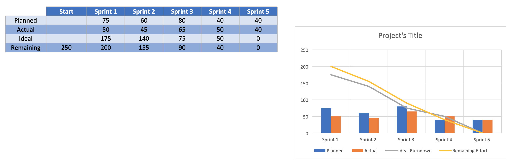

# Overview

Your team has been hired by the university library to build StudySpot, a mobile app for booking group study rooms.
Today, students book rooms on a paper sheet at the front desk. Rooms sit empty because no-shows are never released, groups fight over the few rooms with screens, and students walk across campus only to find everything taken. The library director wants a working app by the end of the semester.

Your team works in 5 two-week sprints. Based on past projects, your team's velocity is 10 story points per sprint, so you can deliver at most 50 points in total. The product owner has written the 10 user stories below and rated how much each one matters to users.

# Product Backlog

User value is set by the product owner: 3 = high, 2 = medium, 1 = low. "Depends on" means that story cannot start until the listed story is finished.

| ID | User story | User value | Depends on |
| --- | --- | --- | --- |
| US1 | As a student, I want to log in with my university account so that I don't need another password. | 3 | — |
| US2 | As a student, I want to see which rooms are free right now so that I can grab one quickly. | 3 | — |
| US3 | As a student, I want to book a room for a specific time slot so that my group has a guaranteed space. | 3 | US1, US2 |
| US4 | As a student, I want to cancel or change my booking so that the room is freed for others. | 2 | US3 |
| US5 | As a student, I want a reminder 15 minutes before my booking so that I don't miss it. | 2 | US3 |
| US6 | As a student, I want to filter rooms by size and equipment (screen, whiteboard) so that I find a room that fits my group. | 2 | US2 |
| US7 | As a student, I want to invite group members to my booking so that everyone gets the time and room. | 2 | US3 |
| US8 | As a librarian, I want a weekly room-usage report so that I can plan staffing and spot no-shows. | 1 | US3 |
| US9 | As a student, I want to rate a room after using it so that the library knows which rooms need attention. | 1 | US3 |
| US10 | As a student, I want a dark mode so that the app is easier on my eyes at night. | 1 | — |

# User Stories Scoring

Working together, score each story on effort, then combines effort with user value to get a priority score.

1. Estimate effort. Use planning poker: each person privately picks a card from 1, 2, 3, 5, 8, everyone reveals at once, and the highest and lowest explain their reasoning. Re-vote until the team agrees. Story points measure relative size and risk, not hours.

2. Calculate the priority score for each story:

3. Rank the stories from highest to lowest priority score (1 = do first). Break ties by user value.

| ID | Short name | User value | Story points | Priority score | Rank |
| --- | --- | --- | --- | --- | --- |
| US1 | University login | 3 |  |  |  |
| US2 | See free rooms | 3 |  |  |  |
| US3 | Book a time slot | 3 |  |  |  |
| US4 | Cancel / change booking | 2 |  |  |  |
| US5 | Booking reminder | 2 |  |  |  |
| US6 | Filter rooms | 2 |  |  |  |
| US7 | Invite group members | 2 |  |  |  |
| US8 | Usage report | 1 |  |  |  |
| US9 | Rate a room | 1 |  |  |  |
| US10 | Dark mode | 1 |  |  |  |
| **Total** |  |  |  |  |  |

# Sprint Planning

Place each user story into 5 sprint following these rules:

* Capacity: no sprint may exceed 10 story points.
* Dependencies: a story can only go in a sprint after the sprint holding the story it depends on.
* Priority: within those limits, higher-ranked stories go earlier.
* Overflow: if your total is over 50 points, decide which low-value stories to drop and be ready to justify it.

# Burndown Chart

A burndown chart shows story points still remaining (y-axis) after each sprint (x-axis: Start, S1–S5). You will draw three lines on the same chart.

1. Ideal line: a straight line from your total points at Start down to 0 at the end of Sprint 5.
2. Planned line: the "points remaining" column from Part 2.
3. Actual line: after you finish your plan, the instructor reveals one reality card per sprint. Fill in the table below, then plot it.

Use the given Burndown Chart Template (xlsx file). 

